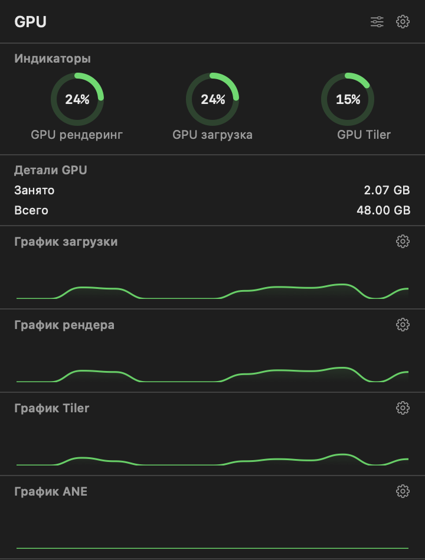
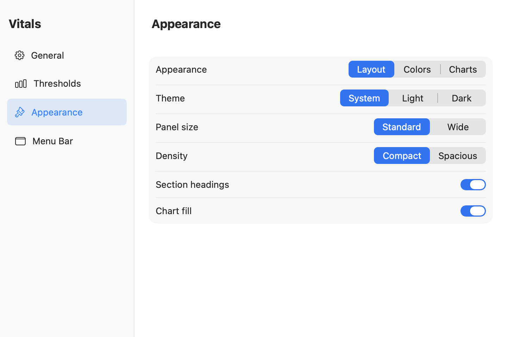

# Vitals

Монитор CPU, GPU и оперативной памяти в строке меню macOS: история нагрузки,
показания температуры и процессы, использующие больше всего ресурсов.

[English](README.md) | **Русский**

## Скриншоты

<p>
  
  
</p>

## Возможности

- Загрузка CPU, доступные показания температуры и самые активные процессы.
- Нагрузка и память GPU, если показатели поддерживаются драйвером.
- Использование RAM и процессы, занимающие больше всего памяти.
- Графики с отметками времени, настройкой порогов и цветов.
- Настройка значков, секций панелей, компоновки и интервалов обновления.
- Светлая, тёмная и системная темы; русский, английский и немецкий языки.
- Необязательные автозапуск при входе и ежедневная проверка GitHub Releases.

Обновления скачиваются и устанавливаются вручную. Предварительные версии
включаются отдельно.

## Требования и ограничения

- **macOS 14.6+**, Intel или Apple Silicon.
- Для сборки: **Xcode 26.2+**, Swift 6.2+ и macOS SDK. Сторонние зависимости не нужны.
- Температура и счётчики GPU зависят от оборудования и драйверов. Недоступная
  температура отображается как `N/A`, неподдерживаемые счётчики GPU могут показывать ноль.
- На Apple Silicon память CPU/GPU общая: показания GPU не означают выделенную VRAM.
- Видимость процессов зависит от разрешений macOS; многоядерная нагрузка процесса может превышать 100%.
- Процент RAM показывает использование памяти, а не давление на память macOS.
- Не все поддерживаемые модели Mac проверены на реальном оборудовании.

## Сборка

```sh
git clone https://github.com/gd182/Vitals.git
cd Vitals
open Vitals.xcodeproj
```

Выберите схему `Vitals` и запустите приложение. Значки появятся в строке меню, не в Dock.

Universal-сборка для разработки:

```sh
xcodebuild -project Vitals.xcodeproj -scheme Vitals -configuration Release \
  -destination 'generic/platform=macOS' -derivedDataPath /tmp/VitalsBuild \
  ARCHS='arm64 x86_64' ONLY_ACTIVE_ARCH=NO CODE_SIGNING_ALLOWED=NO build
```

Результат: `/tmp/VitalsBuild/Build/Products/Release/Vitals.app`.
Эта команда не выполняет подпись Developer ID и нотарификацию.
Подготовка к распространению описана в [чек-листе релиза](docs/RELEASING.md).

## Разработка

<p>
  <a href="https://www.swift.org/"></a>
  <a href="https://isocpp.org/"></a>
</p>

Интерфейс использует SwiftUI и AppKit, сборщики на C++20 связаны со Swift через
Objective-C++. Температуру SMC читают Swift-хелперы. Настройки хранятся в
UserDefaults, ограниченная история графиков остаётся в памяти.

```sh
bash Tests/run-checks.sh
```

Подробнее: [проверки](Tests/README.md), [замеры производительности](docs/PERFORMANCE.md)
и [участие в проекте](CONTRIBUTING.md). Документы по разработке написаны на английском.
Перед отправкой диагностических данных удалите ключи и личные сведения о процессах.

## Лицензия

MIT - см. [LICENSE](LICENSE).
